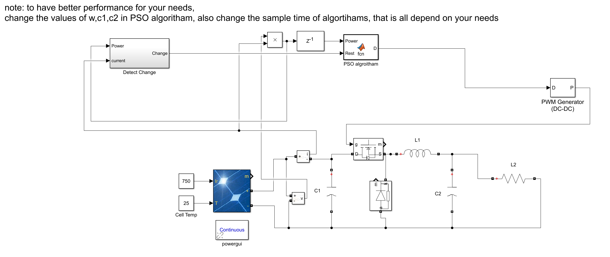

# Particle Swarm Optimization (PSO)-based MPPT Photovoltaic System (Matlab Implementation)

The Particle Swarm Optimization (PSO) algorithm for MPPT photovoltaic systems, including the detection of stationary algorithms when solar irradiance changes, as well as the shut-down algorithm upon reaching the global maximum power point.
This algorithm still requires some work to be perfect; it needs to adjust the values of w, c1, and c2 and the sampling time of the algorithm for better performance.

## Images

<!-- PAYMENT_BLOCK -->

## Get this dataset

- Payment link (Stripe): [Buy now](https://buy.stripe.com/3cs8yP7sY87d0vu9AB)
- Payment QR code: 

<!-- /PAYMENT_BLOCK -->
